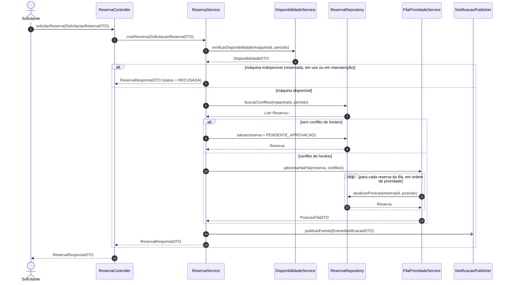
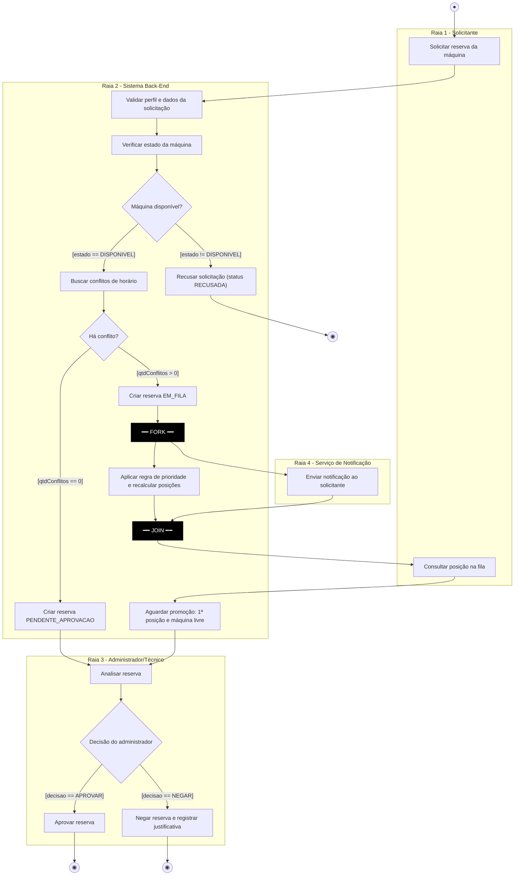
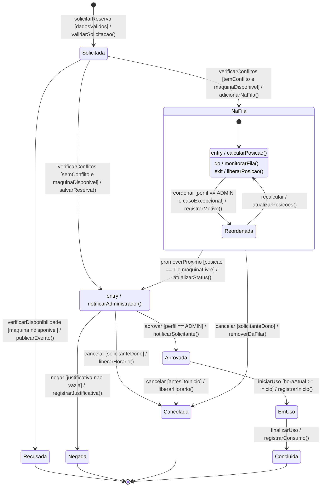
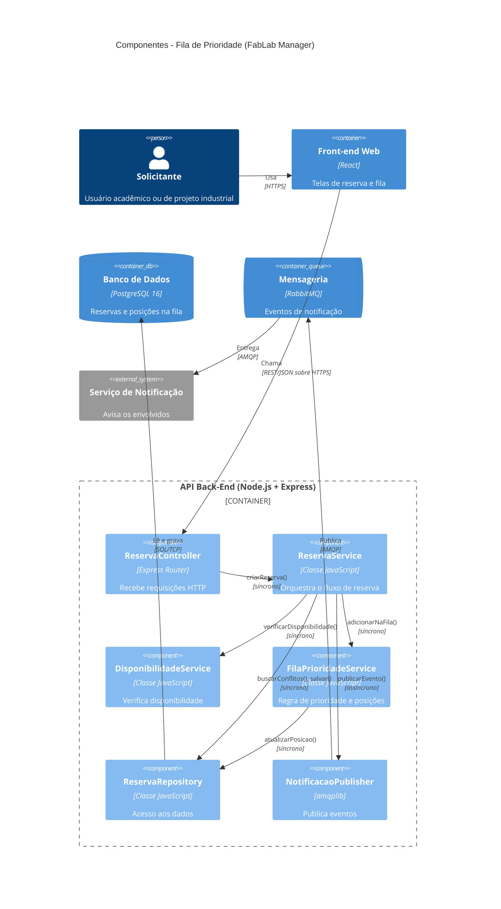

# APS 3 — Dossiê de Arquitetura Viva: Fila de Prioridade (FabLab Manager)

**Aluno:** Nome Sobrenome
**Unidade Curricular:** Modelagem de Software — Engenharia de Software (4º Período)
**Docente:** Prof. Sidney L. da Silva

## 1. Funcionalidade escolhida

**Fila de Prioridade de Reservas de Máquinas.** No FabLab, várias pessoas disputam as mesmas máquinas (cortadoras a laser, impressoras 3D). Quando duas ou mais reservas pedem a mesma máquina no mesmo horário, o sistema:

1. verifica se a máquina está disponível (não pode estar em manutenção, reservada ou em uso);
2. detecta o conflito de horário (RF03);
3. cria a fila de prioridade (RF04) e calcula a posição de cada reserva;
4. permite ao solicitante consultar sua posição (RF05);
5. permite ao administrador/técnico reordenar a fila apenas em casos excepcionais (RF14);
6. envia notificações de forma assíncrona (RF25).

É crítica para o negócio porque uma fila inconsistente (posições duplicadas ou reservas aprovadas em conflito) quebra a confiança dos usuários no sistema.

Estrutura do repositório:

```
docs/architecture/workspace.puml   (C4-PlantUML, código-fonte do Artefato 4)
docs/architecture/adr-0001.md      (Artefato 5)
docs/diagrams/sequencia.mmd        (Artefato 1)
docs/diagrams/atividades.mmd       (Artefato 2)
docs/diagrams/estados.mmd          (Artefato 3)
```

## 2. Classes e operações públicas (base da regra de consistência)

| Classe / Interface | Operações públicas |
|---|---|
| `ReservaController` | `solicitarReserva(SolicitacaoReservaDTO): ReservaResponseDTO` |
| `ReservaService` | `criarReserva(SolicitacaoReservaDTO): ReservaResponseDTO` |
| `DisponibilidadeService` | `verificarDisponibilidade(maquinaId, periodo): DisponibilidadeDTO` |
| `ReservaRepository` | `buscarConflitos(maquinaId, periodo): List<Reserva>`, `salvar(reserva): Reserva`, `atualizarPosicao(reservaId, posicao): Reserva` |
| `FilaPrioridadeService` | `adicionarNaFila(reserva, conflitos): PosicaoFilaDTO`, `consultarPosicao(reservaId): PosicaoFilaDTO`, `promoverProximo(maquinaId): Reserva`, `reordenarExcepcionalmente(reservaId, novaPosicao, motivo): PosicaoFilaDTO` |
| `NotificacaoPublisher` | `publicarEvento(EventoNotificacaoDTO): void` |

**DTOs:**
- `SolicitacaoReservaDTO` (solicitanteId, maquinaId, periodo)
- `ReservaResponseDTO` (reservaId, status, posicao)
- `DisponibilidadeDTO` (maquinaId, disponivel, motivo)
- `PosicaoFilaDTO` (reservaId, posicao, totalNaFila)
- `EventoNotificacaoDTO` (tipo, destinatarioId, reservaId)

## 3. Artefato 1 — Diagrama de Sequência

Chamadas síncronas usam `->>`; a notificação é assíncrona (`-)`). Há dois fragmentos `alt` (um aninhado) e um `loop`. Todas as mensagens correspondem a operações da tabela da seção 2.



## 4. Artefato 2 — Diagrama de Atividades com Raias

Quatro raias (Solicitante, Back-End, Administrador/Técnico, Serviço de Notificação). As guardas de cada decisão são mutuamente exclusivas. O paralelismo está entre o **FORK** e o **JOIN**: recalcular as posições e enviar a notificação acontecem ao mesmo tempo.



## 5. Artefato 3 — Diagrama de Transição de Estados (entidade `Reserva`)

Estado inicial `[*]`, subestados dentro de `NaFila`, quatro estados terminais (`Recusada`, `Negada`, `Cancelada`, `Concluida`), transições no formato `Gatilho [Guarda] / Ação()` e ações internas (`entry /`, `do /`, `exit /`).



## 6. Artefato 4 — Visão de Componentes (C4 Nível 3)

O código-fonte em C4-PlantUML está em `docs/architecture/workspace.puml`. Abaixo, a mesma visão em Mermaid, que o GitHub renderiza.



## 7. Artefato 5 — ADR

Texto completo em `docs/architecture/adr-0001.md`.

### ADR 0001 — Persistir a fila de prioridade no PostgreSQL com bloqueio de linha

**Status:** Proposto

## Contexto

Quando dois ou mais solicitantes pedem a mesma máquina no mesmo horário, o sistema precisa montar uma fila de prioridade e deixar cada solicitante consultar sua posição (RF03, RF04, RF05). O administrador pode reordenar a fila apenas em casos excepcionais (RF14).

Dois problemas técnicos aparecem:

1. Se a fila ficar só na memória da aplicação, ela se perde quando o servidor reinicia.
2. Se duas requisições chegarem ao mesmo tempo, a mesma posição pode ser entregue para duas reservas (condição de corrida), deixando a fila inconsistente.

## Decisão

- A fila será **persistida no PostgreSQL 16**, em uma coluna `posicao` na tabela de reservas, ordenada pela regra de prioridade.
- Ao entrar ou reordenar a fila, a operação roda em uma **transação** com `SELECT ... FOR UPDATE` nas reservas da mesma máquina e do mesmo período, para que só uma requisição altere a fila por vez.
- Os avisos ao solicitante (entrada na fila, promoção, aprovação) serão enviados de forma **assíncrona pelo RabbitMQ**, para a notificação não atrasar a resposta da reserva.

Motivo: o PostgreSQL já é o banco do sistema, então não precisa de tecnologia nova, e o bloqueio de linha garante consistência. O RabbitMQ separa o envio de notificações do fluxo principal.

## Consequências

**Vantagens**
- A fila sobrevive a reinicializações e fica auditável.
- Evita posições duplicadas e estados corrompidos da reserva.
- A resposta ao solicitante é rápida, porque a notificação é assíncrona.

**Débitos e riscos aceitos**
- O bloqueio de linha pode gerar espera quando muitas pessoas disputam a mesma máquina.
- Introduz mais uma peça de infraestrutura (RabbitMQ) para manter.
- Se o RabbitMQ estiver fora do ar, as notificações atrasam (a reserva em si continua funcionando).

## 8. Consistência entre os modelos

| Passo da sequência | Atividade correspondente | Estado / transição da Reserva |
|---|---|---|
| `verificarDisponibilidade` retorna indisponível | "Recusar solicitação" | `Solicitada → Recusada` |
| `buscarConflitos` sem conflito + `salvar` | "Criar reserva PENDENTE_APROVACAO" | `Solicitada → PendenteAprovacao` |
| `buscarConflitos` com conflito + `adicionarNaFila` | "Criar reserva EM_FILA" + Fork | `Solicitada → NaFila` |
| `atualizarPosicao` no `loop` | "Aplicar regra de prioridade" (ramo do Fork) | `entry / calcularPosicao()` |
| `publicarEvento` (assíncrono) | "Enviar notificação" (ramo do Fork) | efeito das transições |
| `promoverProximo` | "Aguardar promoção" | `NaFila → PendenteAprovacao` |
